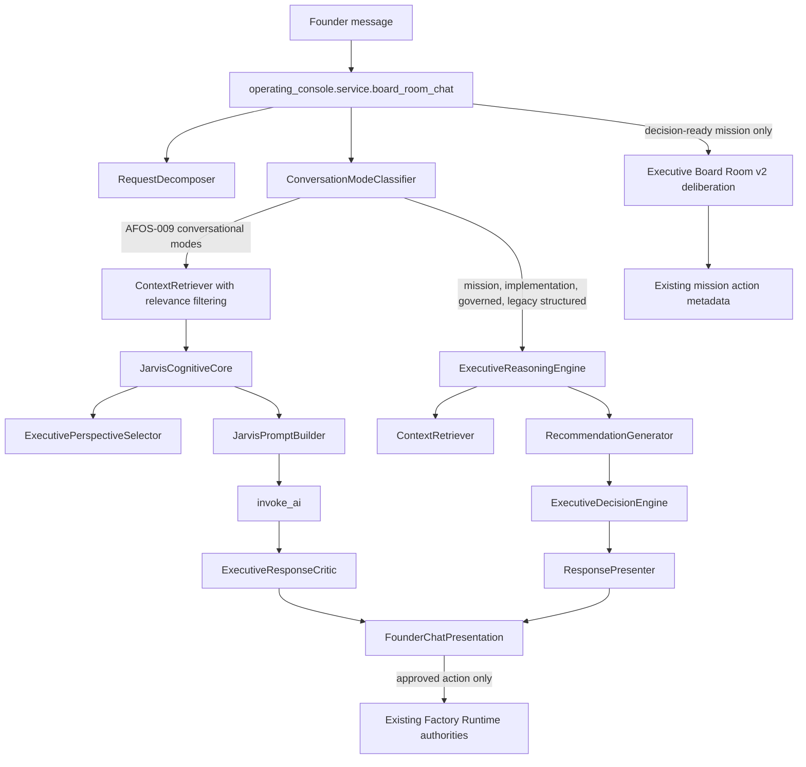

# AFOS-010 Existing Executive Intelligence Audit

## Scope and method

This audit traces the production Board Room source path on `main` at `24947692` after AFOS-009. It is based on imports, callers, return contracts, and tests in the repository. It does not infer runtime use merely from the presence of a class.

## Verified live call graph before AFOS-010

The important branch is the early return in `app/platform/operating_console/service.py:132-163`. Every mode in `CONVERSATIONAL_MODES` calls `JarvisCognitiveCore.respond()` and returns through `present_founder_chat()` before `ExecutiveReasoningEngine.reason()` at line 166. This proves that AFOS-009 bypasses the richer deterministic decision path for ordinary advisory conversation.

## Component inventory and disposition

| Component | File and symbol | Responsibility and output | Live callers | Production status | Authority / overlap | Disposition |
|---|---|---|---|---|---|---|
| Request decomposition | `app/platform/board_room/request_decomposer.py` `RequestDecomposer` | Primary objective, speech act, constraints, questions, lifecycle and execution flags | `operating_console.service`, `ExecutiveReasoningEngine`, tests | Live for all Board Room messages | Canonical request decomposition | **Reuse unchanged as owner** |
| Conversation mode | `app/platform/board_room/conversation_mode.py` `ConversationModeClassifier` | Maps decomposition to conversational or action mode; grants no execution authority | `operating_console.service` | Live for all Board Room messages | Canonical presentation/depth selector | **Reuse and extend only as strategy input** |
| AFOS-009 context selection | `app/platform/board_room/context_retriever.py` `ContextRetriever` | Relevance-filtered read-only Executive Intelligence, Company Brain, Mission Pipeline, Repository Intelligence, Engineering Manager and Journey evidence | `board_room_chat`, `ExecutiveReasoningEngine` | Live | Canonical Board Room context relevance owner; safe failure isolation | **Reuse; add strategy matrix without broad retrieval** |
| Jarvis cognitive core | `app/platform/board_room/cognitive_core.py` `JarvisCognitiveCore` | Perspective selection, prompt composition, one provider call, critic, deterministic fallback | AFOS-009 conversational branch | Live for conversational modes | Canonical provider synthesis coordinator, but currently owns canned judgment fallbacks | **Integrate with existing decision result; narrow fallback** |
| Executive perspectives | `app/platform/board_room/executive_perspective.py` | Selects CEO Advisor, CTO, CPO, VP Engineering and Principal Engineer prompt lenses | `JarvisCognitiveCore` | Live | Advisory lens only, no state or authority | **Reuse; connect to structured evidence and bound to at most three** |
| Prompt builder | `app/platform/board_room/jarvis_prompt_builder.py` | Modular identity, mode, evidence, action, style and privacy prompt | `JarvisCognitiveCore` | Live | Canonical provider prompt owner | **Reuse; inject compact executive brief** |
| Response critic | `app/platform/board_room/executive_response_critic.py` | Rejects leakage, rigid templates, short non-answers and mission over-triggering | `JarvisCognitiveCore` | Live | Canonical bounded quality gate, currently presentation-heavy | **Extend with judgment signals and one bounded revision** |
| Founder presentation | `app/platform/operating_console/founder_presentation.py` `FounderChatPresentation` | Whitelist-only `founder-chat-v1`; recursively removes reasoning and technical fields | `board_room_chat` | Live | Sole browser-facing contract | **Retain unchanged as owner** |
| Executive reasoning pipeline | `app/platform/board_room/executive_reasoning_engine.py` `ExecutiveReasoningEngine` | Context retrieval, execution-first read-only handoff, recommendation generation and adaptive presentation | Non-conversational branch in `board_room_chat`; checks | Live but bypassed by AFOS-009 conversational modes | Read-only orchestration; overlaps Jarvis coordination but contains canonical decision adapter | **Reuse capabilities; narrow to legacy compatibility/orchestrated decision adapter** |
| Recommendation adapter | `app/platform/board_room/recommendation_generator.py` `RecommendationGenerator` | Adapts `ExecutiveDecisionEngine` result to Board Room reasoning contract | `ExecutiveReasoningEngine` | Live on non-conversational path | Contract adapter, not separate reasoning authority | **Reuse as compatibility adapter; expose compact brief builder** |
| Executive decision engine | `app/platform/board_room/executive_decision_engine.py` `ExecutiveDecisionEngine` | Objective, constraints, evidence, options, weighted criteria, uncertainty, recommendation, risk, impact and inaction consequence | `RecommendationGenerator` | Live only behind `ExecutiveReasoningEngine`; bypassed for AFOS-009 conversation | Canonical substantive decision reasoning in Board Room | **Reuse as canonical executive decision owner** |
| Adaptive response presenter | `app/platform/board_room/response_presenter.py` `ResponsePresenter` | Comparison, prioritization, diagnosis, critique, roadmap, execution and governed-action rendering | `ExecutiveReasoningEngine` | Live on non-conversational path | Duplicates some natural-language synthesis now owned by Jarvis/provider | **Narrow to deterministic fallback and compatibility presentation** |
| Executive Intelligence | `app/platform/executive_intelligence/service.py` `build_executive_intelligence_briefing` | Fresh `executive-state-v1` read model over repository, mission, capability, GitHub, deploy, verification, health, sprint, release and Board Room evidence | `ContextRetriever`, Mission Control, Executive Office and other read models | Live and authoritative for executive state | Canonical live evidence read model, no execution authority | **Reuse selectively through ContextRetriever** |
| Company Brain | `app/platform/company_brain/service.py` | Read-only company memory summary from existing repository | `ContextRetriever` | Live for strategic modes when enabled/available | Context source, not decision owner | **Reuse only for company alignment and prior decisions** |
| Repository Intelligence | `app/platform/repository_intelligence/service.py` | Repository areas and architecture evidence | `ContextRetriever` | Live for relevant conversation modes | Canonical repository read source | **Reuse for architecture, diagnosis and implementation decisions** |
| Engineering Manager | `app/platform/engineering_manager/service.py` | Planning/management-only engineering summary | `ContextRetriever` | Live for deeper non-conversational path; filtered out by most AFOS-009 conversation | Planning evidence source, no repository mutation | **Reuse for implementation decisions only** |
| Mission Pipeline / Journey Inspector | `app/platform/pipeline/mission_pipeline.py`; `app/platform/journey_inspection/service.py` | Durable mission projection and mission-specific journey evidence | `ContextRetriever`, Executive Intelligence | Live | Canonical read projections; runtime remains authority | **Reuse only for status, continuation or explicit mission reference** |
| Executive Board Room v2 | `app/platform/services/board_room_agents.py` `run_board_room_deliberation` | Nine rule-based executive positions, evidence references, consensus, effort, risk and action metadata | API, orchestrator, and `board_room_chat` only when `_decision_ready_mission_requested()` | Live but narrowly used | Contributor contracts are useful; recommendations are mostly fixed and duplicate decision logic | **Narrow to perspective contracts/compatibility; do not use fixed consensus as canonical judgment** |
| Board Room orchestrator | `app/platform/services/board_room_orchestrator.py` | Selects Board Room agents and extracts risks for its API | API callers | Live separate API, not AFOS-009 chat path | Compatibility surface | **Retain as compatibility adapter** |
| AFOS-002 Executive Decision Center | `app/platform/executive_decision/service.py` | Chooses workflow UI actions and guided workflow type | Executive decision APIs/checks | Live as action-routing product surface, not substantive Board Room reasoning | Workflow guidance, not same responsibility as `ExecutiveDecisionEngine` | **Retain; name/document as action router** |
| Executive Office | `app/platform/executive_office/service.py` | Founder briefing adapter over Executive Intelligence | Executive Office API/check | Live | Read-model adapter | **Retain** |
| PR #392 Executive AI interfaces | No `app/platform/executive_ai/` package exists on current main | Historical CEO/CTO/COO/CFO interface implementation is absent from current tree | None | Not live | No reusable current contract | **Retire historically; do not recreate** |
| MC-BR-INT-03 adaptive modes | Superseded behavior survives in `ResponsePresenter` and `operating_console.service` | Structured mode-specific rendering and action metadata | Non-conversational branch | Partially live | Presentation overlaps AFOS-009 natural synthesis | **Retain compatibility; Jarvis owns conversational presentation** |

## Exact current bypass and underuse

1. `board_room_chat()` classifies the request with `RequestDecomposer` and `ConversationModeClassifier`.
2. For every AFOS-009 conversational mode, it retrieves relevant sources and calls `JarvisCognitiveCore` directly.
3. `JarvisPromptBuilder._evidence_summary()` reduces those sources to available source names, source statuses and aggregate observations. Rich evidence, options, constraints and uncertainty never reach the provider.
4. `ExecutiveDecisionEngine.evaluate()` is therefore not called for strategic advice, comparison, product review, architecture review, diagnosis or brainstorming on the AFOS-009 branch.
5. If the provider draft is rejected, `JarvisCognitiveCore.fallback()` supplies mode- and phrase-specific prose without using the existing decision result.
6. Non-conversational implementation and governed paths still call `ExecutiveReasoningEngine`, which calls `RecommendationGenerator`, which calls `ExecutiveDecisionEngine`.

The defect is integration and responsibility fragmentation, not missing executive intelligence.

## Canonical owners after AFOS-010

| Responsibility | Canonical owner |
|---|---|
| Request decomposition | `RequestDecomposer` |
| Conversation mode and reasoning depth | `ConversationModeClassifier` plus a deterministic strategy/depth mapping |
| Context relevance | `ContextRetriever` |
| Executive decision reasoning | existing `ExecutiveDecisionEngine` |
| Decision-contract adaptation | `RecommendationGenerator` |
| Perspective selection | `ExecutivePerspectiveSelector` |
| Provider synthesis | `JarvisCognitiveCore` with `JarvisPromptBuilder` |
| Response criticism | `ExecutiveResponseCritic` |
| Founder presentation | `FounderChatPresentation` |
| Mission approval and persistence | existing operating-console action and mission-run services |
| Workflow execution | existing Factory Runtime authorities |

## Implementation recommendation

Add one thin read-only orchestration contract between AFOS-009 mode selection and the existing decision engine. It should select Tier 0-3 depth, invoke `ExecutiveDecisionEngine` only for modes that benefit, adapt its result into a compact executive brief, attach bounded perspective contributions derived from that same evidence, and pass the brief to the existing prompt builder. It must not own decisions, state, actions or execution.

Keep Tier 0 on the current fast path. For Tier 1-3, make one deterministic reasoning pass and one provider synthesis call. Allow at most one critic-requested revision. Replace phrase-specific fallback judgment with deterministic rendering from the executive brief. Preserve `FounderChatPresentation` and all current action/approval paths.

## Audit conclusion

The central hypothesis is **confirmed**. AFOS-009 improved routing and presentation but bypasses the live `ExecutiveReasoningEngine` / `ExecutiveDecisionEngine` path for the conversations where substantive judgment matters most. Existing Executive Intelligence is retrieved but underused. AFOS-010 should reconnect these components, not create a new Executive Mind, council, state store or execution authority.
