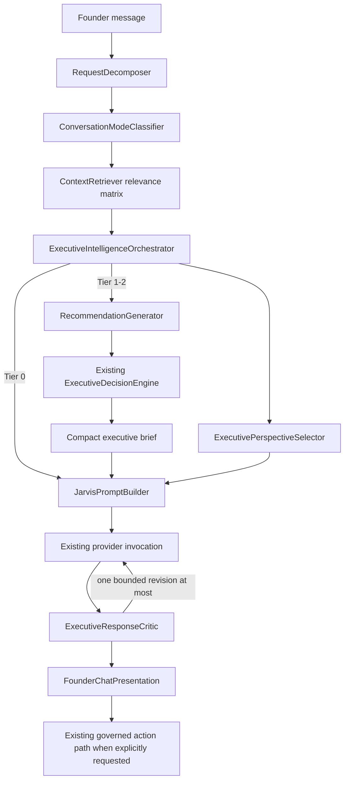

# AFOS-010 Unified Cognitive Architecture

## Runtime path

`ExecutiveIntelligenceOrchestrator` is a thin adapter. It selects depth, invokes the existing decision path, limits perspective contributions to three, and builds a private brief. It does not implement option scoring, persist state, expose an API, or execute actions.

## Reasoning depth

| Tier | Modes | Context | Decision engine | Provider calls |
|---|---|---|---|---|
| 0 | direct answer, explanation, status, capability, limitation | Minimal relevant sources | No | One; no revision without a decision brief |
| 1 | product, architecture, diagnosis, strategy, critique, comparison, roadmap, brainstorming | Strategy-specific read sources | Existing engine once | One healthy call; at most one bounded revision |
| 2 | Material cross-functional questions | Same filtered sources; at most three perspectives | Existing engine once | Same bound as Tier 1 |
Explicit implementation requests continue through the existing non-conversational mission-preparation and governance path; they are not assigned a conversational reasoning tier.

## Context relevance

| Strategy | Sources |
|---|---|
| Direct explanation | Executive Intelligence and Repository Intelligence when needed |
| Product review | Executive Intelligence, Company Brain, Repository Intelligence |
| Architecture / diagnosis | Executive Intelligence and Repository Intelligence |
| Strategy / brainstorming | Executive Intelligence, Company Brain, Repository Intelligence |
| Capability / limitation | No broad operating context |
| Mission status / continuation | Durable mission, workflow and Journey evidence |
| Implementation decision | Existing full planning context through `ExecutiveReasoningEngine` |

Mission continuity remains suppressed for unrelated conversation. The compact brief filters mission counts and repository-area counts when they are not relevant to the selected strategy.

## Private executive brief

The brief contains only bounded decision outputs: objective, strategy, verified evidence, inferences, unknowns, up to three options, decisive trade-off, position, challenge, consequence, risk, confidence and bounded perspective contributions. It is prompt input only. `FounderChatPresentation` remains the sole browser boundary and removes internal reasoning fields recursively.

## Reliability and cost

- No additional provider call is required for a healthy response.
- A rejected Tier 1-2 draft receives one bounded revision; no reflection loop exists.
- Tier 0 never invokes the decision engine.
- Provider failure falls back to a concise rendering of the structured brief, not exact-prompt canned prose.
- DeepSeek configuration, model selection, secrets and runtime provider behavior are unchanged.

## Compatibility

`ExecutiveReasoningEngine`, `ResponsePresenter`, Executive Board Room v2, AFOS-002 action routing and their APIs remain available as compatibility paths. AFOS-010 changes the conversational integration path only and does not introduce an execution authority.
