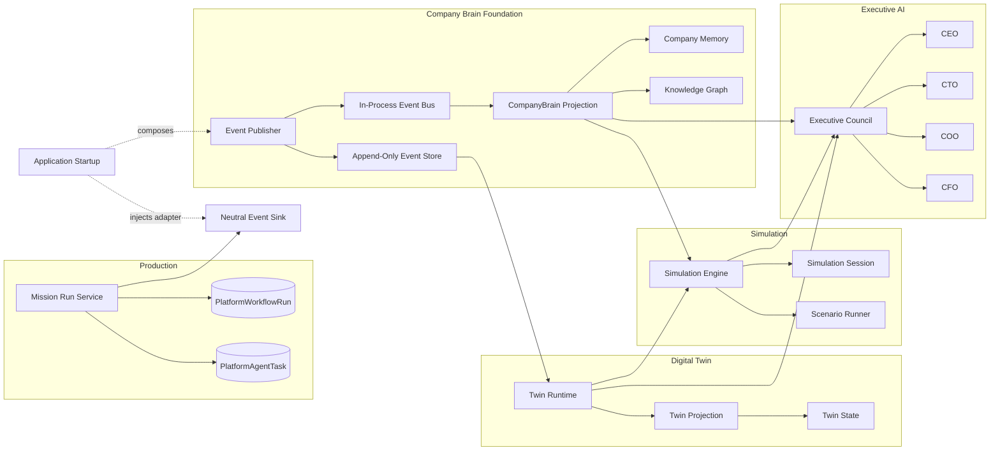

# Phase 1 Architecture Review

## Review Scope

This review covers the AI Software Factory V2 Phase 1 Company Brain Foundation on
branch `v2-phase-1-company-brain-foundation`. It examines every new component,
its direct dependencies, all existing production files modified by Phase 1, and
the direction of runtime dependencies.

## Executive Finding

Phase 1 preserves `PlatformWorkflowRun` and `PlatformAgentTask` as Production's
canonical state. Digital Twin, Simulation Engine, and Executive AI are strictly
downstream consumers and have no import or call path from Production.

Production lifecycle code now depends only on a neutral `EventSink` contract.
The application composition root registers the Company Brain adapter at FastAPI
startup when event publishing is enabled. This inversion removes Company Brain,
Digital Twin, Simulation Engine, and Executive AI imports from the canonical
mission runtime.

| Boundary | Result | Evidence |
|---|---|---|
| Production domain -> Company Brain | Zero | Mission runtime imports only `app.platform.events.event_sink` |
| Production -> Digital Twin | Zero | No production import or call found |
| Production -> Simulation Engine | Zero | No production import or call found |
| Production -> Executive AI | Zero | No production import or call found |
| Downstream systems -> Production writes | Zero | New downstream modules expose projections or placeholders only |

## System Direction



The application startup module is the composition root. Production domain code
does not select or import a downstream intelligence implementation.

## New Components

### Neutral Platform Event Boundary

| File | Component | Responsibility | Direct dependencies |
|---|---|---|---|
| `events/event_sink.py` | `EventSink`, `NoOpEventSink` | Defines the Production-owned outbound event contract, no-op default, registration functions, and emission facade | Python standard library only |

### Company Brain Foundation

| File | Component | Responsibility | Direct dependencies |
|---|---|---|---|
| `company_brain/event_models.py` | `DomainEvent` | Frozen, deeply immutable event envelope and event factory | Python standard library only |
| `company_brain/event_store.py` | `ImmutableEventStore` | Thread-safe append-only in-process event history; rejects duplicate IDs | `event_models.DomainEvent` |
| `company_brain/event_bus.py` | `InProcessEventBus` | Synchronous subscriber dispatch with subscriber failure isolation | `event_models.DomainEvent` |
| `company_brain/event_subscriber.py` | `EventSubscriber`, `RecordingSubscriber` | Subscriber interface and simple recording implementation | `event_models.DomainEvent` |
| `company_brain/event_publisher.py` | Domain event publisher | Optional event creation, append, and dispatch controlled by `COMPANY_BRAIN_EVENTS_ENABLED` | Event bus, event models, event store, `CompanyBrain` |
| `company_brain/event_sink.py` | `CompanyBrainEventSink` | Adapter from the neutral platform event contract to Company Brain publishing | Company Brain event publisher |
| `company_brain/company_brain.py` | `CompanyBrain` | Receives events, preserves history, projects memory and knowledge, exposes replay and timeline views | Event models, event store, knowledge graph, memory |
| `company_brain/knowledge_graph.py` | `KnowledgeGraphProjection` | Event-derived aggregate nodes and causation edges | `event_models.DomainEvent` |
| `company_brain/memory.py` | `CompanyMemory` | Ordered company timeline and mission-specific history | `event_models.DomainEvent` |
| `company_brain/foundation_check.py` | Foundation validation | Verifies immutability, append-only behavior, replay, optional publishing, projection, simulation safety, and dependency injection | All four Phase 1 packages; test-only |

### Digital Twin

| File | Component | Responsibility | Direct dependencies |
|---|---|---|---|
| `digital_twin/twin_state.py` | `TwinState` | In-memory projection of missions, workflows, agents, tasks, and Board Room decisions | Python standard library only |
| `digital_twin/twin_event_handlers.py` | `apply_domain_event` | Incrementally applies domain events without writing to Production | Company Brain event model, Twin State |
| `digital_twin/twin_projection.py` | `rebuild_twin` | Reconstructs Twin State entirely from an event stream | Company Brain event model, twin handlers, Twin State |
| `digital_twin/twin_runtime.py` | `DigitalTwin` | Handles events, replays history, and returns snapshots | Company Brain event model and Digital Twin projection modules |
| `digital_twin/__init__.py` | Package facade | Exports `DigitalTwin` | Twin Runtime |

### Simulation

| File | Component | Responsibility | Direct dependencies |
|---|---|---|---|
| `simulation/simulation_session.py` | `Scenario`, `SimulationSession` | Defines scenario assumptions and isolated simulation session state | Python standard library only |
| `simulation/scenario_runner.py` | `ScenarioRunner` | Returns non-mutating placeholder scenario results | Simulation Session |
| `simulation/simulation_engine.py` | `SimulationEngine`, prediction/assessment interfaces | Replays events into the twin and exposes placeholder prediction, risk, impact, and execution simulation interfaces | CompanyBrain, DomainEvent, DigitalTwin, ScenarioRunner, SimulationSession |
| `simulation/__init__.py` | Package facade | Exports simulation engine and session | Simulation Engine, Simulation Session |

### Executive AI

| File | Component | Responsibility | Direct dependencies |
|---|---|---|---|
| `executive_ai/ceo.py` | `CEO` | Executive role interface with injected Brain, Twin, and Simulation dependencies; no autonomous reasoning | Injected objects only |
| `executive_ai/cto.py` | `CTO` | CTO specialization of executive interface | CEO interface |
| `executive_ai/coo.py` | `COO` | COO specialization of executive interface | CEO interface |
| `executive_ai/cfo.py` | `CFO` | CFO specialization of executive interface | CEO interface |
| `executive_ai/executive_council.py` | `ExecutiveCouncil` | Composes the four roles over shared injected observational dependencies | CompanyBrain, DigitalTwin, SimulationEngine, executive role classes |
| `executive_ai/__init__.py` | Package facade | Exports `ExecutiveCouncil` | Executive Council |

## Modified Existing Files

### `app/platform/company_brain/__init__.py`

This existing package initializer now exports `CompanyBrain`, `DomainEvent`,
`create_domain_event`, and `publish_domain_event`. The modification provides a
stable package facade for the new foundation. It does not alter Production
state, APIs, schemas, or execution paths by itself.

### `app/platform/operating_console/mission_run_service.py`

This production file now:

- imports only the neutral `emit_domain_event` boundary;
- observes newly accepted missions and workflows;
- observes mission and workflow advancement;
- observes blocked workflow updates;
- emits completion events if a future canonical stage is exactly `completed`;
- catches all publisher exceptions and logs only the exception type.

The hooks occur after canonical persistence or queueing. They do not alter the
mission state, workflow state, task records, lifecycle envelopes, governance,
credentials, or worker activation order. With events disabled, the publisher
returns immediately and creates no event. With events enabled, it adds an
in-process observational side effect.

This preserves functional runtime behavior and does not create a dependency on
any downstream intelligence package.

### `app/platform/server.py`

The FastAPI startup composition root resets the neutral sink to its no-op
default, checks the Company Brain feature flag, and injects
`CompanyBrainEventSink` only when enabled. This is dependency composition at the
application boundary, not a Production domain dependency.

## Dependency Inventory

### Production-side dependency

```text
mission_run_service
    -> events.event_sink.emit_domain_event
        -> EventSink protocol
        -> NoOpEventSink by default
```

At startup, the application composition root may replace the no-op sink with a
Company Brain adapter. The mission runtime neither imports nor discovers that
adapter.

### Downstream dependency chain

```text
DomainEvent
    -> CompanyBrain projections
    -> DigitalTwin projections
    -> SimulationEngine interfaces
    -> ExecutiveCouncil interfaces
```

No edge in this chain points back to `mission_run_service`,
`PlatformWorkflowRun`, `PlatformAgentTask`, or any Production mutation service.

### Existing pre-Phase-1 naming dependency

The repository already contains a file-backed Company Brain service used by
Board Room context and executive intelligence. That pre-existing service is
separate from the new event-driven foundation but shares the
`app.platform.company_brain` package namespace. Therefore, a repository-wide
claim that Production has never depended on anything named Company Brain would
also be inaccurate. This review distinguishes the new event-driven components
from that existing read-only context service.

## Production Authority and Mutation Analysis

| Concern | Canonical owner | Phase 1 behavior |
|---|---|---|
| Mission runtime state | `PlatformWorkflowRun` | Unchanged |
| Agent task state | `PlatformAgentTask` | Unchanged |
| Mission queueing | Existing mission runtime | Unchanged |
| Founder governance | Existing auth and approval services | Unchanged |
| Event history | New in-process append-only event store | Observational only |
| Company memory | Event-derived projection | No Production writes |
| Digital Twin | Event replay projection | No Production writes |
| Simulation | Placeholder over snapshots | Reports `production_mutated: false` |
| Executive AI | Injected interfaces | No autonomous action or Production writes |

No new database table, browser storage, API route, external service, deployment
operation, or Production state mutation was introduced.

## Verification Evidence

The following checks passed with the Phase 1 changes present:

- `python3 -m compileall app`
- `python3 -m app.platform.company_brain.foundation_check`
- `python3 -m app.platform.company_brain.startup_injection_check`
- `python3 -m app.platform.company_brain.check`
- `python3 -m app.platform.events.event_check`
- `python3 -m app.platform.data.events.event_check`
- `python3 -m app.platform.operating_console.runtime_reconciliation_check`
- `python3 -m app.platform.operating_console.action_flow_check`
- `python3 -m app.platform.execution.workflow_check`
- `python3 -m app.platform.journey_inspection.check`
- `python3 -m app.platform.persistence.python39_compatibility_check`
- `python3 -m app.platform.persistence.check`
- `python3 -m app.platform.agents.lease_safety_check`
- `python3 -m app.platform.ui.action_progress_check`
- `python3 -m app.platform.ui.login_module_boundary_check`
- `python3 -m app.platform.ui.ui_module_size_check`
- `git diff --check`

The import audit found no Production domain imports of
`app.platform.company_brain`, `app.platform.digital_twin`,
`app.platform.simulation`, or `app.platform.executive_ai`. Company Brain appears
only in the application startup composition root and pre-existing read-only
context services.

## Zero-Dependency Boundary Demonstration

1. `mission_run_service.py` imports `app.platform.events.event_sink`, not Company
   Brain.
2. `NoOpEventSink` is installed by default, so the runtime operates without any
   downstream package being initialized.
3. `app/platform/server.py` is the sole Phase 1 composition point that knows both
   the neutral contract and Company Brain adapter.
4. Startup imports and registers the adapter only when
   `COMPANY_BRAIN_EVENTS_ENABLED=true`.
5. Application shutdown restores `NoOpEventSink`, preventing configured global
   state from leaking into another application instance.
6. Digital Twin, Simulation, and Executive AI remain downstream-only.
7. No downstream component exposes a Production mutation dependency.

## Relationship to PR #391

PR #391 (`mc-runtime-01d-durable-mission-execution-ui`) and Phase 1 both modify
`app/platform/operating_console/mission_run_service.py` and
`app/platform/server.py`.

- The server changes are in separate regions: Phase 1 adds lifecycle
  composition, while PR #391 changes Mission Execution route targets.
- The mission service changes are conceptually compatible: Phase 1 adds neutral
  event emission around canonical transitions, while PR #391 adds durable
  execution read models and continuation behavior.
- The shared-file overlap creates moderate merge-conflict risk even though the
  intended behavior does not conflict.
- Whichever branch merges second should rebase onto the first and rerun runtime
  reconciliation, Board Room action flow, Mission Execution UI, persistence,
  and downstream import checks.

## Review Decision

**Acceptable as an optional observational foundation.** Canonical runtime
behavior and ownership remain intact. Production domain code has zero runtime
dependency on Company Brain, Digital Twin, Simulation Engine, or Executive AI;
the application startup composition root owns optional adapter registration.
